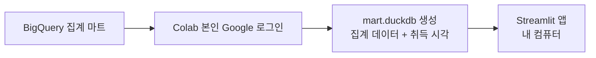
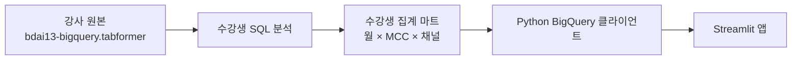

# Streamlit과 데이터 연결

기본 방법은 **Colab에서 본인 Google 로그인으로 5주차 마트를 읽어 `mart.duckdb` 파일로 저장하고, Streamlit 앱이 그 파일을 읽게 하기**입니다. 마트는 5주차에 만든 작은 합계 표입니다. 서비스 계정 키가 필요 없고 CSV로 옮기는 단계도 없습니다. 공개 배포와 BigQuery 직접 연결은 필요할 때 고르는 선택 경로입니다.

[Streamlit 앱 ZIP 받기](../downloads/streamlit-app.zip){ .md-button .md-button--primary }
[Colab에서 DuckDB 노트북 열기](https://colab.research.google.com/github/Eunjung-Cho/bdai13-bigquery/blob/main/docs/downloads/bigquery-duckdb.ipynb){ .md-button }

!!! note "먼저 만들어야 하는 표"
    `mart_monthly_mcc`는 원본 테이블이 아닙니다. `transactions`, `users`, `cards`만 보이는 처음 상태에서는 아직 없습니다. 5주차 실습에서 `YOUR_PROJECT.bdai13.mart_monthly_mcc`를 만든 뒤에만 이 페이지와 Colab 노트북을 실행합니다. 이 수업의 원본과 마트는 모두 `asia-northeast3`(서울)에 둡니다.

## 1. 기본 경로 Colab + DuckDB



Streamlit이 BigQuery를 직접 읽으려면 서비스 계정 키를 만들고 권한까지 설정해야 합니다. 이 경로는 내 Google 로그인으로 마트를 한 번 꺼내 파일에 담으므로, 앱은 키 없이 파일만 읽습니다. 앱을 열 때마다 BigQuery를 조회하지도 않습니다. DuckDB는 여러 표를 파일 하나에 담아 SQL로 읽을 수 있는 도구입니다.

위의 **Colab에서 DuckDB 노트북 열기** 버튼을 누르고 다음 순서로 진행합니다. 처음 열 때 “Google에서 작성하지 않은 노트북” 안내가 나오면, 이 강의 사이트의 링크로 열었는지와 보이는 코드를 확인한 뒤 계속합니다.

1. 설정 셀의 `QUERY_PROJECT`, `MART_TABLE`을 본인 값으로 바꾸고 `LOCATION`이 `asia-northeast3`인지 확인. 노트북 기본값 `bdai13-bigquery`는 강사 프로젝트입니다.
2. **런타임 > 모두 실행**.
3. 본인 Google 로그인에서 BigQuery 접근 허용.
4. 노트북이 BigQuery에서 집계 결과를 가져와 `mart_monthly_mcc`와 `snapshot_metadata` 테이블을 만듭니다.
5. 행 수, 금액 합, 분모 합이 같다는 출력을 확인한 뒤 `mart.duckdb` 다운로드.
6. [streamlit-app.zip](../downloads/streamlit-app.zip)을 풀고 `mart.duckdb`를 `app.py` 옆으로 옮깁니다.
7. [실습](../week6/lab.md)의 A3 순서로 앱을 실행합니다.

ZIP 안의 `.streamlit/secrets.toml`에 아래 설정이 이미 들어 있습니다. 앱이 어느 파일을 읽을지 정하는 값이며 비밀 정보는 없습니다.

```toml
[data]
backend = "duckdb"
snapshot = "mart.duckdb"
```

DuckDB 파일은 사진처럼 저장한 때의 결과를 담은 사본입니다. 이런 사본을 스냅샷이라고 합니다. 새 데이터를 반영하려면 노트북을 다시 실행해 파일을 교체합니다. Colab을 상시 웹서버로 열거나 외부 터널로 Streamlit을 호스팅하는 방식은 사용하지 않습니다. 노트북은 데이터 준비만 담당합니다.

DuckDB는 BigQuery의 조회 권한이나 무료 쿼리 한도를 없애 주지 않습니다. Colab에서 BigQuery 조회가 실패하면 그 권한부터 해결해야 하며, 존재하지 않는 데이터를 DuckDB로 연결할 수는 없습니다. 5주차 마트의 필수 열은 `tx_month`, `mcc`, `channel`, `amount_usd`, `txn_count`, `fraud_count`, `fraud_labeled_count`입니다. 이름을 바꾸면 코드도 함께 수정해야 합니다.

## 2. 선택 / Community Cloud로 공개 배포

`localhost` 주소는 내 컴퓨터에서만 열립니다. 다른 사람에게 앱 URL을 주려면 GitHub와 Streamlit Community Cloud에 올립니다. 서비스 계정 키는 여전히 필요 없습니다.

1. `app.py`, `data_access.py`, `requirements.txt`, `.streamlit/config.toml`, `mart.duckdb`를 자신의 새 GitHub 저장소 가장 바깥 폴더에 넣습니다. `mart.duckdb`가 공개 가능한 집계만 담았는지 확인합니다.
2. [Streamlit Community Cloud](https://share.streamlit.io/)에 GitHub 계정으로 연결합니다.
3. **Create app**에서 저장소, 브랜치, `app.py`를 선택합니다. Python은 3.14로 맞춥니다.
4. Advanced settings의 Secrets에 위 `[data]` 세 줄을 입력합니다.
5. 배포 후 생성된 앱 URL에서 월, 채널, MCC 필터를 바꾸고, SQL과 동일 조건의 합계를 대조합니다.

공개 앱에는 집계 데이터도 방문자에게 공개됩니다. 공개 가능한 집계만 연결하고, 무료 호스팅의 휴면과 자원 제한을 고려하세요. 데이터를 갱신하려면 Colab에서 파일을 다시 만들어 저장소의 파일을 교체합니다.

이 강의 사이트는 미리 만든 글과 그림을 보여 주는 GitHub Pages에서 열립니다. Python을 실행하는 Streamlit 앱은 Community Cloud에 따로 올립니다. 완성 예시는 [예시 앱](https://bdai13-card-dashboard.streamlit.app/)에서 볼 수 있습니다.

## 3. 선택 / BigQuery 직접 연결

앱을 열 때마다 최신 마트를 읽어야 할 때만 고릅니다. 수업 실습에는 필요하지 않습니다. 앱 코드는 같고 [직접 연결용 ZIP](../downloads/streamlit-starter.zip)에 설정 예시가 들어 있습니다. Google의 BigQuery 클라이언트 라이브러리 빠른 시작은 **결제 등록 없는 샌드박스 사용을 지원**합니다. 무료 한도 내에서 쿼리를 실행하며, 무료 한도 초과, 샌드박스 만료, 계정 권한은 따로 관리합니다.



앱은 2,400만 원본 거래를 메모리로 가져오지 않습니다. 5주차에서 만든 작고 검증 가능한 마트만 읽습니다. 원본에서 마트를 만드는 비용과 앱에서 마트를 읽는 비용도 구분합니다.

### 3-1. Colab에서 연결 확인하기

```python
from google.colab import auth
auth.authenticate_user()
```

화면의 Google 계정 로그인을 완료합니다. 토큰이나 인증키를 코드에 붙이지 않습니다.

```python
from google.cloud import bigquery

QUERY_PROJECT = 'YOUR_PROJECT'
client = bigquery.Client(project=QUERY_PROJECT)
job = client.query('SELECT 1 AS connected')
print(list(job.result()))
```

`connected=1`이 보이면 다음으로 자신의 집계 마트를 읽습니다. 계정 로그인 성공이 해당 테이블의 조회 권한까지 보장하지는 않습니다.

```python
query = '''
SELECT tx_month, mcc, channel, amount_usd,
       txn_count, fraud_count, fraud_labeled_count
FROM `YOUR_PROJECT.bdai13.mart_monthly_mcc`
WHERE tx_month >= DATE '2018-01-01'
  AND tx_month < DATE '2019-01-01'
'''
config = bigquery.QueryJobConfig(maximum_bytes_billed=100_000_000)
job = client.query(query, job_config=config, location='asia-northeast3')  # 마트의 실제 리전
df = job.result().to_dataframe(create_bqstorage_client=False)
display(df.head())
print('집계 행 수:', len(df), '처리 바이트:', job.total_bytes_processed)
```

제공된 앱에는 조회 기간을 안전하게 전달하는 설정(매개변수), 가져올 행 수 제한, 이전 결과를 잠시 다시 쓰는 기능(캐시)이 더해져 있습니다. `maximum_bytes_billed`는 1회 쿼리 상한이고, `LIMIT`는 반환 행 제한입니다. 역할이 다릅니다.

### 3-2. 앱의 인증 준비

Colab에서는 사람이 직접 Google 로그인합니다. 앱 서버는 대신 **서비스 계정**이라는 프로그램용 계정으로 데이터를 읽습니다.

| 설정 | 범위 | 준비 주체 |
| --- | --- | --- |
| BigQuery API 활성화 | 쿼리를 실행할 프로젝트 | 프로젝트 소유자 |
| BigQuery Job User | 실행 프로젝트 | 수강생 또는 강사 관리 계정 |
| BigQuery Data Viewer | 공개 가능한 집계 마트 테이블 | 마트 소유자 |
| 서비스 계정 인증정보 | Streamlit Secrets | 키를 만든 본인 |

**원본 전체 읽기 권한이나 프로젝트 Owner를 앱에 부여하지 않습니다.** 이 앱은 저장된 집계 테이블을 읽으므로 해당 테이블에 필요한 조회 권한만 줍니다. 한 서비스 계정 키를 반 전체에 공용으로 배포하지 않습니다. 실제 키는 각자 Secrets에 입력합니다. 조직 정책으로 서비스 계정 키 생성이 차단되어 있으면 정책을 끄지 말고 기본 경로를 사용합니다.

### 3-3. 앱의 설정값

직접 연결용 ZIP의 압축을 풀고 `.streamlit/secrets.toml.example`을 읽습니다. 로컬에서는 같은 폴더의 `secrets.toml`에, Community Cloud에서는 앱의 Secrets 화면에 입력합니다.

```toml
[data]
backend = "bigquery"
query_project = "YOUR_PROJECT"
table = "YOUR_PROJECT.bdai13.mart_monthly_mcc"
location = "asia-northeast3"
maximum_bytes_billed = 100000000
```

Google에서 받은 서비스 계정 JSON은 앱이 로그인할 때 쓸 정보를 담은 파일입니다. 파일 안의 항목 이름과 값을 예제의 `[gcp_service_account]` 아래에 맞춰 입력합니다. 줄바꿈이 포함된 private_key는 예제 양식에 맞춰 입력합니다. **실제 키를 GitHub에 올리거나 AI에게 보내지 않습니다.** 프로젝트 ID, 테이블 ID, 리전만 AI에 알려 주면 코드 수정에 충분합니다.

앱의 캐시는 최대 10분이며 무제한 실시간 갱신이 아닙니다. 앱에서 보이는 데이터 취득 시각과 마트의 최신 작성 시각도 구분합니다.

## 수업 전 확인할 세 가지

- 본인 계정으로 5주차 마트 조회가 되는가?
- Python 3.12~3.14가 설치되어 있고 `streamlit-app.zip`을 받아 두었는가?
- 필터를 바꿨을 때 SQL과 앱의 합계, 분모가 일치하는가?

출처: [DuckDB Python](https://duckdb.org/docs/stable/clients/python/overview.html), [Colab FAQ](https://research.google.com/colaboratory/faq.html), [무료 배포](https://docs.streamlit.io/deploy/streamlit-community-cloud), [BigQuery Python, 샌드박스](https://docs.cloud.google.com/bigquery/docs/quickstarts/quickstart-client-libraries), [Streamlit BigQuery 연결](https://docs.streamlit.io/develop/tutorials/databases/bigquery).
