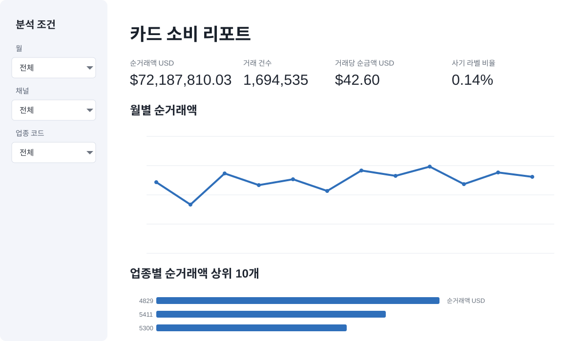

# 6주차 실습 / 내 컴퓨터에서 Streamlit 앱 실행하고 고치기

[강의](lecture.md) / [최종 제출](assignment.md) / [데이터 연결 안내](../reference/dashboard-connection.md)

[Streamlit 앱 ZIP 받기](../downloads/streamlit-app.zip){ .md-button .md-button--primary }
[Colab 노트북 열기](https://colab.research.google.com/github/Eunjung-Cho/bdai13-bigquery/blob/main/docs/downloads/bigquery-duckdb.ipynb){ .md-button }

직접 실습 45분입니다. 완성된 앱을 받아 한 부분씩 바꾸므로 Python 선수 지식은 필요하지 않습니다. 서비스 계정과 GitHub 저장소도 필요하지 않습니다.

## A 데이터 파일을 만들고 앱 실행하기 / 25분

### A1 5주차 마트 확인 / 5분

BigQuery 탐색기에서 `YOUR_PROJECT.bdai13` 아래에 `v_transactions_clean`과 `mart_monthly_mcc`가 보이는지 확인합니다. `YOUR_PROJECT`를 본인 프로젝트 ID로 바꾸고 실행합니다.

```sql
SELECT
    COUNT(*) AS row_count,
    MIN(tx_month) AS first_month,
    MAX(tx_month) AS last_month,
    SUM(txn_count) AS txn_count,
    SUM(amount_usd) AS net_amount_usd
FROM `YOUR_PROJECT.bdai13.mart_monthly_mcc`;
```

| 항목 | 기대값 |
| --- | --- |
| `row_count` | 1,536행 |
| `first_month` ~ `last_month` | 2018-01-01 ~ 2018-12-01 |
| `txn_count` | 1,694,535건 |
| `net_amount_usd` | $72,187,810.03 |

표가 없으면 [5주차 실습](../week5/lab.md) SQL을 다시 실행합니다.

### A2 Colab에서 mart.duckdb 만들기 / 10분

1. [Colab 노트북](https://colab.research.google.com/github/Eunjung-Cho/bdai13-bigquery/blob/main/docs/downloads/bigquery-duckdb.ipynb)을 엽니다.
2. **모두 실행 전에** 설정 셀의 세 값을 본인 것으로 바꿉니다. 노트북 기본값 `bdai13-bigquery`는 강사 프로젝트입니다.

    | 값 | 넣을 내용 |
    | --- | --- |
    | `QUERY_PROJECT` | `YOUR_PROJECT` 자리에 본인 프로젝트 ID |
    | `MART_TABLE` | `YOUR_PROJECT.bdai13.mart_monthly_mcc` |
    | `LOCATION` | `asia-northeast3` |

3. 메뉴에서 **런타임 > 모두 실행**을 누릅니다.
4. 처음 실행 경고가 나오면 **무시하고 계속**을 누릅니다.
5. Google 로그인 창에서 BigQuery 접근을 허용합니다.
6. 마지막 셀이 `mart.duckdb`를 내려받는지 확인합니다. 파일 크기는 약 800KB입니다.

Colab에서 고친 값은 내 화면에만 적용되며 GitHub 원본을 바꾸지 않습니다. 중간에 멈추면 런타임을 다시 연결하고 처음 셀부터 다시 모두 실행합니다. 처리량은 약 107KB로 1회 상한 100MB보다 훨씬 작습니다.

### A3 앱 실행하기 / 10분

필요한 것은 Python 3.12~3.14, 터미널(Windows는 명령 프롬프트, 맥은 터미널 앱), 패키지를 받을 인터넷입니다. Python 3.15는 패키지 설치에서 실패하므로 [Python 3.14](https://www.python.org/downloads/release/python-31410/)를 설치합니다. Windows는 설치 첫 화면에서 **Add python.exe to PATH**를 체크합니다.

1. [streamlit-app.zip](../downloads/streamlit-app.zip)을 내려받습니다.
2. 압축을 풉니다. Windows는 파일을 우클릭하고 **모두 압축 풀기**를 고릅니다.
3. A2에서 받은 `mart.duckdb`를 `app.py` 옆으로 옮깁니다.

    ```text
    streamlit-app/
    ├── app.py                화면
    ├── data_access.py        데이터 읽기
    ├── requirements.txt      패키지 목록
    ├── mart.duckdb           Colab에서 받아 직접 넣기
    └── .streamlit/
        ├── secrets.toml      읽을 파일 설정. 이미 들어 있으므로 고치지 않기
        └── config.toml       화면 테마
    ```

4. 이 폴더에서 터미널을 엽니다. Windows는 탐색기 주소창에 `cmd`를 입력하고 Enter를 누릅니다. 맥은 터미널에 `cd`와 공백을 입력하고 폴더를 끌어다 놓은 뒤 Enter를 누릅니다.
5. 아래 두 줄을 차례로 실행합니다. 첫 줄은 처음 한 번만 실행하며 1~2분 걸립니다. 맥은 `python` 대신 `python3`을 씁니다.

    ```bash
    python -m pip install -r requirements.txt
    python -m streamlit run app.py
    ```

6. 브라우저 주소창에 `http://localhost:8501`을 입력합니다. 앱을 끌 때는 터미널에서 Ctrl+C를 누릅니다.

순거래액 $72,187,810.03, 거래 건수 1,694,535가 보이면 성공입니다. 드롭다운 3개, 지표 4개, 차트 2개가 있어야 합니다.

[{ loading=lazy }](https://bdai13-card-dashboard.streamlit.app/)

## B 화면을 한 부분씩 바꾸기 / 10분

코드를 저장한 뒤 브라우저를 새로 고치면 바뀐 내용이 보입니다.

### B1 제목과 질문을 맞추기 / 2분

`app.py`에서 `st.title('카드 소비 리포트')`의 글자만 자신의 프로젝트 질문에 맞게 바꿉니다. 다른 함수나 연결 코드는 아직 바꾸지 않습니다.

### B2 필터를 읽고 조작하기 / 3분

월 드롭다운에서 `2018-03`을 고르고 채널 드롭다운에서 `온라인`을 고릅니다. 지표 카드와 두 차트가 같은 조건을 따르는지 봅니다. 이어서 월과 채널을 다시 `전체`로 바꾸고 2018년 전체 숫자로 돌아오는지 확인합니다.

### B3 AI에게 작은 수정 요청 / 5분

```text
이 Streamlit 앱의 업종 Top 10 막대 차트를 Top 5로 바꿔 줘.
data_access.py와 .streamlit 폴더는 바꾸지 마.
다른 차트나 지표 정의는 바꾸지 마.
어느 줄이 왜 바뀌는지 Python 초급자에게 설명해 줘.
```

변경 전후 순거래액 카드가 같고, 막대 수만 최대 5개로 줄었는지 봅니다. 업종 수가 원래 5개 미만이면 실제 개수만 보입니다. 가짜 업종을 채우지 않습니다.

## C SQL과 숫자 대조 / 10분

아래 쿼리는 마트에 저장된 여러 줄을 다시 더해 앱과 같은 숫자를 구합니다. `YOUR_PROJECT`를 바꾸고 BigQuery에서 실행합니다.

```sql
SELECT
    SUM(amount_usd) AS net_amount_usd,
    SUM(txn_count) AS txn_count,
    SUM(fraud_count) AS fraud_count,
    SUM(fraud_labeled_count) AS labeled_count,
    SAFE_DIVIDE(SUM(amount_usd), SUM(txn_count)) AS amount_per_txn,
    SAFE_DIVIDE(SUM(fraud_count), SUM(fraud_labeled_count)) AS fraud_rate
FROM `YOUR_PROJECT.bdai13.mart_monthly_mcc`
WHERE tx_month >= DATE '2018-01-01' AND tx_month < DATE '2019-01-01';
```

한 달을 검증할 때는 `tx_month = DATE '2018-03-01'`로 기간 조건을 바꾸고 앱에서도 2018-03만 선택합니다. 온라인만 확인하려면 `AND channel = '온라인'`을 추가합니다. SQL 결과와 앱 화면이 모두 아래 값과 같으면 통과입니다.

| 검사 조건 | 순거래액 | 거래 건수 | 사기 라벨 / 분모 | 사기 라벨 비율 |
| --- | --- | --- | --- | --- |
| 2018년 전체 | $72,187,810.03 | 1,694,535 | 2,382 / 1,694,535 | 0.14% |
| 2018-03 | $6,139,579.16 | 143,927 | 225 / 143,927 | 0.16% |
| 2018-03 온라인 | $997,883.96 | 17,630 | 0 / 17,630 | 0.00% |

비율 0.0014가 화면에 0.14%로 표시되는 것은 같은 값입니다. 프로젝트에 맞게 마트를 바꿨다면 위 값 대신 자신의 SQL 결과와 앱을 맞춥니다. 끝나면 옆 사람과 화면의 숫자를 비교합니다.

## D 디벨롭 / 선택, 수업 후

먼저 [강의의 두 질문](lecture.md)에 답하고 차트 설계표를 씁니다. 그다음 AI에게 맡기거나 아래 코드를 직접 붙여 넣습니다. 세 코드 모두 이 앱과 수업 마트에서 실행을 확인했습니다.

### D1 데이터 기준 시각 보여 주기

`app.py`에서 `data, _ = load_mart(**settings)`를 찾아 `_`를 `meta`로 바꿉니다. 그 아래 `if data.empty:` 바로 위에 한 줄을 넣습니다.

```python
data, meta = load_mart(**settings)
```

```python
st.caption(f"데이터 기준 시각: {meta['loaded_at']}")
```

### D2 월별 사기 라벨 비율

`app.py` 맨 아래에 붙여 넣습니다.

```python
st.subheader('월별 사기 라벨 비율')
fraud = filtered.groupby('tx_month', as_index=False).agg(
    fraud=('fraud_count', 'sum'), labeled=('fraud_labeled_count', 'sum'))
fraud = fraud[fraud.labeled > 0]  # 분모가 0인 달은 계산하지 않습니다.
fraud['rate_pct'] = fraud.fraud / fraud.labeled * 100
st.line_chart(fraud, x='tx_month', y='rate_pct', x_label='거래 월', y_label='사기 라벨 비율 %')
```

### D3 업종별 사기 라벨 건수

```python
st.subheader('업종별 사기 라벨 건수 상위 10개')
risk = filtered.groupby('mcc', as_index=False).agg(fraud=('fraud_count', 'sum'))
risk = risk.sort_values(['fraud', 'mcc'], ascending=[False, True]).head(10)
st.bar_chart(risk, x='mcc', y='fraud', horizontal=True,
             x_label='MCC 업종 코드', y_label='사기 라벨 건수')
```

붙여 넣은 뒤 C의 세 조건을 다시 대조합니다. 지표 카드 숫자는 그대로여야 합니다.

## 흔한 문제

| 현상 | 확인 |
| --- | --- |
| Colab에서 표를 찾을 수 없다고 나옴 | `QUERY_PROJECT`와 `MART_TABLE`을 본인 값으로 바꿨는가? 5주차 마트가 있는가? |
| Location 오류 | `LOCATION`이 `asia-northeast3`인가? |
| Colab이 멈춤 | 런타임을 다시 연결하고 처음 셀부터 다시 모두 실행 |
| Colab에서도 조회 실패 | DuckDB로 우회할 수 없음. 로그인 계정과 BigQuery 권한부터 확인 |
| `python`을 찾을 수 없다고 나옴 | 설치할 때 Add python.exe to PATH를 체크했는가? 맥은 `python3` |
| 패키지 설치 실패 | `python --version`이 3.15이면 3.14를 설치 |
| `DLL load failed` | [Microsoft Visual C++ 재배포 패키지](https://learn.microsoft.com/ko-kr/cpp/windows/latest-supported-vc-redist) 설치 |
| 화면에 ‘마트를 읽지 못했습니다’ | `mart.duckdb`가 `app.py` 옆에 있는가? 이름이 `mart (1).duckdb`로 바뀌지 않았는가? |
| 화면에 ‘데이터 연결을 준비하세요’ | `.streamlit/secrets.toml`이 있는가? `app.py`가 있는 폴더에서 실행했는가? |
| 앱 숫자가 SQL과 다름 | 월, 채널, MCC 선택. 파일을 바꿨다면 Ctrl+C로 앱을 끄고 다시 실행 |
| 사기율이 SQL 결과와 다름 | 사기 여부를 아는 건수로 나눴는지, 반올림 차이인지, 나누는 수가 0인지 확인 |

## 완료 기준

- 앱이 `mart.duckdb`를 읽어 드롭다운 3개, 지표 4개, 차트 2개를 보여 줍니다.
- 필터를 바꾸면 숫자가 바뀝니다.
- 제목과 차트 수정 내용, 검증 근거를 설명할 수 있습니다.
- 최소 두 조건에서 SQL과 앱 숫자가 일치합니다.
- AI 사용 기록과 데이터 경로, 갱신 방식을 남겼습니다.

출처: [Streamlit 문서](https://docs.streamlit.io/), [DuckDB Python](https://duckdb.org/docs/stable/clients/python/overview.html), 사용자 수정 지시.
