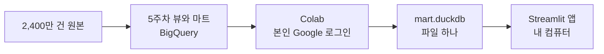
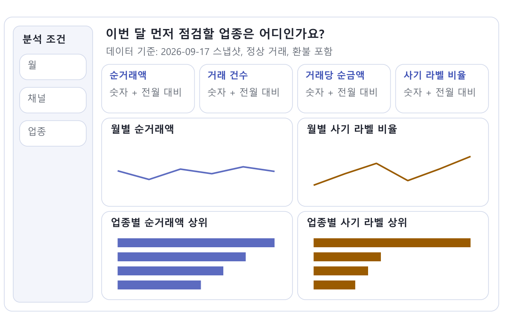

# 6주차 / 검증한 SQL을 Streamlit 앱으로 전달하기

2026년 11월 6일 금요일 20:00–22:00 / 120분

## 수업 전에 받아 둘 자료

내려받을 파일은 ZIP 하나입니다. `mart.duckdb`는 수업 중에 Colab에서 직접 만듭니다.

[Streamlit 앱 ZIP 받기](../downloads/streamlit-app.zip){ .md-button .md-button--primary }
[Colab 노트북 열기](https://colab.research.google.com/github/Eunjung-Cho/bdai13-bigquery/blob/main/docs/downloads/bigquery-duckdb.ipynb){ .md-button }
[Python 3.14 설치 페이지](https://www.python.org/downloads/release/python-31410/){ .md-button }

| 자료 | 무엇에 쓰나요 | 준비 방법 |
| --- | --- | --- |
| [streamlit-app.zip](../downloads/streamlit-app.zip) | 앱 코드와 설정이 든 폴더 | 내려받아 압축을 풉니다 |
| [Colab 노트북](https://colab.research.google.com/github/Eunjung-Cho/bdai13-bigquery/blob/main/docs/downloads/bigquery-duckdb.ipynb) | BigQuery 마트를 `mart.duckdb` 파일로 저장 | 링크를 열기만 하면 됩니다. 내려받거나 설치하지 않습니다 |
| [Python 3.14](https://www.python.org/downloads/release/python-31410/) | 내 컴퓨터에서 앱 실행 | 터미널에서 `python --version`으로 확인합니다. 맥은 `python3 --version`입니다 |
| 5주차 마트 | `YOUR_PROJECT.bdai13.mart_monthly_mcc` | 5주차 실습에서 이미 만들었습니다. 없으면 [5주차 실습](../week5/lab.md) SQL을 다시 실행합니다 |

!!! warning "Python은 3.12~3.14만 됩니다"
    python.org 첫 화면의 최신 버전인 3.15는 패키지 설치에서 실패합니다. 3.15이거나 Python이 없으면 위 설치 페이지에서 Windows installer (64-bit)를 받고, 설치 첫 화면에서 **Add python.exe to PATH**를 체크합니다. 맥은 같은 페이지의 macOS installer를 받습니다.

오늘은 “내가 확인한 숫자를 다른 사람도 같은 기준으로 읽을 수 있는가?”에 답합니다. Python 문법 전체를 배우기보다 완성된 앱을 내 컴퓨터에서 실행하고, 좋은 대시보드의 기준으로 점검한 뒤 한 부분씩 고칩니다.

[실습](lab.md) / [최종 제출](assignment.md) / [데이터 연결 안내](../reference/dashboard-connection.md) / [예시 앱](https://bdai13-card-dashboard.streamlit.app/)

## 수업 진행

| 시간 | 활동 | 방식 |
| --- | --- | --- |
| 20:00–20:10 | 큰 그림, 왜 Colab과 DuckDB를 거치는가 | 설명 10분 |
| 20:10–20:35 | 마트 확인, Colab 실행, 앱 실행 | 실습 25분 |
| 20:35–20:50 | 좋은 대시보드와 디벨롭 방향 | 설명 15분 |
| 20:50–21:10 | 앱 한 부분 수정, SQL 대조 | 실습 20분 |
| 21:10–21:15 | 휴식 | 5분 |
| 21:15–21:43 | 7분 발표 × 4팀 | 발표 28분 |
| 21:43–21:53 | 개인정보와 공정성 토론 | 토론 10분 |
| 21:53–22:00 | 포트폴리오 정리 | 정리 7분 |

직접 실습은 45분입니다. ZIP 다운로드와 Python 설치는 수업 전에 끝내 둡니다. 수업 중에 처음부터 설치하면 발표 시간이 부족합니다. 팀 수가 4팀을 넘으면 별도 발표 시간을 공지합니다.

## 1. 왜 Colab과 DuckDB를 거치나요



Streamlit이 BigQuery를 직접 읽으려면 서비스 계정 키(앱 전용 인증 파일)를 만들고 권한까지 설정해야 합니다. Colab은 내 Google 로그인만으로 마트를 꺼내고, DuckDB는 그 결과를 파일 하나에 담습니다. 그래서 앱은 키 없이 이 파일만 읽습니다. 설정이 단순해지고, 앱을 열 때마다 BigQuery를 조회하지 않아도 됩니다.

오늘 BigQuery에서 새로 만드는 것은 없습니다. 아래 두 가지는 5주차 실습에서 `YOUR_PROJECT.bdai13`에 이미 만들었습니다. 리전은 `asia-northeast3`(서울)입니다.

- `v_transactions_clean` 뷰: 금액, 날짜, 채널을 분석하기 좋게 고칩니다.
- `mart_monthly_mcc` 마트: 2018년 거래를 월 × 업종 × 채널로 합쳐 둔 작은 표입니다. 1,536행입니다.

파일에는 저장할 때의 결과가 담깁니다. 사진처럼 그때의 상태를 남긴 사본이라 스냅샷이라고 합니다. 새 결과를 보려면 노트북을 다시 실행해 파일을 바꿉니다. 자신의 경로와 갱신 방식을 설명할 수 있어야 합니다.

## 2. DuckDB / 파일 하나로 쓰는 분석용 데이터베이스

서버를 띄우지 않고, 파일 하나에 표를 담아 SQL로 읽습니다.

| 구분 | BigQuery | DuckDB |
| --- | --- | --- |
| 실행 위치 | Google 클라우드 서버 | 내 컴퓨터 또는 Colab |
| 저장 형태 | 클라우드의 테이블 | `.duckdb` 파일 하나 |
| 필요한 것 | 로그인, 권한, 프로젝트 | 파일과 파이썬 |
| 비용 | 읽은 양만큼 과금 | 무료 오픈소스 |

```python
import duckdb

con = duckdb.connect("mart.duckdb")
con.sql("""
    SELECT channel, SUM(txn_count) AS txn_count
    FROM mart_monthly_mcc
    GROUP BY channel
""").show()
```

`mart.duckdb`에는 `mart_monthly_mcc`와 `snapshot_metadata` 두 표가 들어 있습니다. BigQuery와 DuckDB는 일부 함수 이름이 다르므로, BigQuery SQL을 그대로 붙여 넣어도 항상 실행되는 것은 아닙니다.

더 읽을 자료: [DuckDB 공식 문서](https://duckdb.org/docs/stable/), [DuckDB Python 안내](https://duckdb.org/docs/stable/clients/python/overview.html), [위키독스 나만의 분석용 DuckDB 활용 with Python](https://wikidocs.net/book/15474).

## 3. Streamlit / 파이썬으로 웹 화면을 만드는 도구

```python
st.title('카드 소비 리포트')
chosen = st.selectbox('월', ['전체', '2018-03'])
st.metric('거래 건수', 120)
st.line_chart(monthly, x='tx_month', y='amount_usd')
```

| 코드 | 화면 |
| --- | --- |
| `st.title` | 페이지 제목 |
| `st.selectbox` | 드롭다운 필터 |
| `st.metric` | 숫자 카드 |
| `st.line_chart` | 선 차트 |

**120은 함수 설명을 위한 가상 숫자**입니다. 실제 앱은 마트에서 집계한 값을 넣습니다. 괄호 안의 값을 바꾸면 표시가 달라집니다. `monthly` 같은 DataFrame은 Python에서 쓰는 표라고 이해하면 충분합니다. SQL 결과의 열이 Python 표의 열로 이어집니다.

필터를 바꾸면 코드가 위에서 아래로 다시 실행됩니다. 그래서 숫자 카드와 차트가 같은 조건을 따릅니다. 앱은 `localhost`라는 내 컴퓨터 주소에서 열리고, 필터 3개, 지표 4개, 차트 2개가 보입니다.

더 읽을 자료: [Streamlit 공식 문서](https://docs.streamlit.io/), [치트시트](https://docs.streamlit.io/develop/quick-reference/cheat-sheet), [앱 갤러리](https://streamlit.io/gallery).

## 4. 필터는 질문의 범위를 바꾼다

월, 채널, 업종 필터를 바꾸면 포함되는 마트 행이 달라집니다. 같은 조건을 SQL에도 적용해야 비교할 수 있습니다. 월간 마트에서 2018-03-15부터 2018-03-20까지처럼 일별 범위를 분석할 수는 없습니다. 원본보다 작아진 대신 상세 수준이 줄었습니다.

**연습용 예시:** A그룹은 2건에 총 100달러, B그룹은 3건에 총 900달러를 썼다고 해 봅시다. 전체는 5건에 1,000달러이므로 거래당 평균은 200달러입니다. 그룹별 평균인 50달러와 300달러를 다시 평균내면 175달러가 되어 답이 달라집니다. 앱에서 필터를 바꿀 때도 먼저 금액과 건수를 각각 더한 뒤 나눠야 합니다.

사기 라벨 비율 역시 사기 건수 합÷라벨 확인 건수 합입니다. 라벨 분모가 없으면 0%가 아니라 계산 불가입니다. 활성 고객 수는 이번 월×MCC×채널 마트에 없으므로 임의로 표시하지 않습니다.

## 5. 좋은 대시보드는 결정을 돕는 화면입니다

| 조건 | 뜻 |
| --- | --- |
| 결정이 정해져 있습니다 | 누가, 언제, 무슨 결정에 쓰는지 한 문장으로 말할 수 있습니다 |
| 숫자에 비교 기준이 있습니다 | 과거, 목표, 다른 집단, 한계값과 비교해야 좋고 나쁨이 보입니다 |
| 시선 흐름이 설계되어 있습니다 | 요약에서 상세로 읽힙니다. 그래프는 6개 이내로 줄입니다 |
| 믿을 수 있고 계속 관리됩니다 | 지표 정의가 하나이고 원천 숫자와 맞습니다. 쓰면서 계속 고칩니다 |

만들기 전에 아래 다섯 가지를 묻습니다. 아니오가 나오면 대시보드 대신 일회성 분석으로 끝내는 편이 낫습니다.

- 숫자를 보고 바로 행동할 수 있나요?
- 같은 질문이 앞으로도 반복되나요?
- 여러 사람이 같은 숫자를 보나요?
- 비슷한 자료가 아직 없나요?
- 계속 관리할 사람과 시간이 있나요?

## 6. 먼저 답할 두 질문

| 질문 | 나쁜 답 | 좋은 답 |
| --- | --- | --- |
| Q1 누가, 언제, 무슨 결정을 내리나요? | 다 같이 보려고요. 리스크팀이요. | 리스크 담당자가 매월 첫 주 회의에서 어느 업종을 먼저 점검할지 정합니다. |
| Q2 어떤 숫자를 무엇과 비교해 어떻게 행동하나요? | 사기율이요. 전체 지표를 한눈에 보고 싶어요. | 업종의 사기 라벨 비율이 전체 평균의 3배를 넘으면 그 업종의 탐지 규칙을 점검합니다. |

3배는 수업용 예시입니다. 숫자는 비교 기준이 있어야 읽힙니다.

| 비교 기준 | 우리 데이터의 예 |
| --- | --- |
| 과거 | 2018년 3월 순거래액, 전월 대비 +11.1% |
| 목표 | 월 목표 대비 달성률 (목표 표를 더 붙여야 합니다) |
| 다른 집단 | 사기 라벨 비율, 오프라인 0.15%, 온라인 0.06% |
| 한계값 | 전체 평균의 3배를 넘는 업종만 표시 |

## 7. 지금 앱을 네 조건으로 점검하기

| 조건 | 지금 앱 | 빠진 것 |
| --- | --- | --- |
| 결정 | 제목만 있습니다 | 누가 무슨 결정에 쓰는지 모릅니다 |
| 비교 기준 | 지표 4개가 숫자만 있습니다 | 전월이나 평균보다 좋은지 모릅니다 |
| 시선 흐름 | 차트 2개가 모두 순거래액입니다 | 사기 위험은 숫자 하나로만 보입니다 |
| 신뢰와 관리 | 업종 코드만 있습니다 | 업종 이름, 기준 시각, 정의가 없습니다 |

그대로 둘 것도 있습니다. 지표, 추이, 업종으로 이어지는 순서, 분자와 분모를 합산한 뒤 나누는 계산, 공통 필터, SQL과 숫자를 맞춰 볼 수 있는 구조입니다.

## 8. 디벨롭 3단계

| 단계 | 할 일 | 필요한 것 |
| --- | --- | --- |
| (1) 문구와 비교 | 제목을 질문으로, 전월 대비, 기준 시각과 정의, 업종 이름표 | 지금 마트로 가능 |
| (2) 차트 더하기 | 월별 사기 라벨 비율, 업종별 사기 라벨 건수, 업종×채널 표 | 지금 마트로 가능 |
| (3) 마트 넓히고 운영 | 2017년 추가와 전년 대비, 목표값 표, 사용자 의견과 사용 기록, 안 보는 차트 제거, 정의 재점검 | 마트 SQL과 노트북 날짜 조건 변경 |

`st.metric`의 `delta`로 비교 기준을 붙입니다. 비율은 낮을수록 좋으므로 색을 뒤집습니다.

```python
st.metric('순거래액 USD', '$6,139,579', delta='+11.1%')
st.metric('사기 라벨 비율', '0.16%', delta='+0.02%p', delta_color='inverse')
```

업종 이름은 공식 코드표를 기준으로 붙입니다. 라벨이 없는 MCC에 AI가 임의로 업종명을 붙이면 잘못된 정보가 됩니다. 월이 없으면 데이터가 없는 것인지 거래가 0인지 확인하고, 전월 대비는 달력을 맞춘 뒤 계산합니다. 고칠 때마다 SQL과 숫자를 다시 맞춰 봅니다. 2단계 차트는 [실습 D](lab.md)에 붙여 넣을 수 있는 코드가 있습니다.

## 9. 차트 설계표와 화면 배치

코드를 고치기 전에 표부터 씁니다. 질문마다 목적, 차트, 차원, 측정값을 정하면 필요 없는 차트가 먼저 걸러집니다.

| 질문 | 목적 | 표현 방식 | 차원 | 측정값 | 판정 |
| --- | --- | --- | --- | --- | --- |
| 월별 순거래액은? | 기간 추이 | 라인 | `tx_month` | `amount_usd` | 유지 |
| 어느 업종의 거래액이 큰가? | 단순 비교 | 가로 막대 | `mcc` | `amount_usd` | 유지 |
| 사기 라벨 비율은 어느 달에 높은가? | 기간 추이 | 라인 | `tx_month` | `fraud_count`, `fraud_labeled_count` | 추가 |
| 사기 라벨은 어느 업종에 몰리는가? | 단순 비교 | 가로 막대 | `mcc` | `fraud_count` | 추가 |
| 업종별로 채널 차이가 있는가? | 테이블 제시 | 하이라이트 테이블 | `mcc`, `channel` | `fraud_count`, `fraud_labeled_count` | 추가 |
| 온라인 비중이 달라지는가? | 구성 비율 | 누적 막대 | `tx_month`, `channel` | `amount_usd` | 제외 |

온라인 비중은 매달 15.8~16.4%로 거의 변하지 않아 차트로 만들 이유가 없습니다. 그려 보기 전에 숫자로 확인했기 때문에 뺄 수 있습니다.

표가 끝나면 배치를 그립니다. 종이, PPT, Figma, 엑셀 중 편한 도구면 됩니다.



왼쪽 위에 핵심 숫자를 두고 지표, 추이, 업종 순서로 읽히게 합니다. 제목은 질문으로 쓰고 필터는 옆에 둡니다.

## 10. 차트에서 행동까지

| 단계 | 질문 | 우리 데이터 |
| --- | --- | --- |
| 결과 해석 | 무엇이 보이나요? | 사기 라벨 2,382건 중 537건(22.5%)이 업종 코드 5311에 몰려 있습니다 |
| 인사이트 | 어디서, 왜 그런가요? | 5311은 거래 비중이 3.6%인데 사기 라벨 비율은 0.89%로 전체 0.14%의 약 6배입니다. 537건 중 519건이 오프라인입니다 |
| 행동 | 무엇을 해야 하나요? | 리스크 담당자가 이번 달 안에 5311 오프라인 거래의 탐지 규칙을 점검합니다 |

지금 화면에서 5311은 거래액 7위 막대로만 보이고 사기 정보가 없습니다. 그래서 2단계 차트를 더합니다. 합성 데이터이므로 실제 업종 특성으로 일반화하지는 않습니다.

행동은 최소 3개를 쓰고 담당자와 기한까지 붙입니다. 행동이 하나도 나오지 않으면 Q1, Q2로 돌아가 다시 정합니다.

## 11. AI에게 앱 수정 맡기기

```text
# 역할
너는 Streamlit 대시보드를 설계해 본 BI 컨설턴트야.

# 맥락
- 보는 사람과 결정: 리스크 담당자가 매월 먼저 점검할 업종을 정한다
- 표: mart_monthly_mcc (한 행 = 월 x 업종 x 채널)
- 컬럼: tx_month, mcc, channel, amount_usd, txn_count,
        fraud_count, fraud_labeled_count

# 작업
이 결정에 필요한 차트를 3개 이내로 추천하고 app.py를 고쳐 줘.
데이터 연결과 지표 정의는 바꾸지 마.
비율은 분자와 분모를 각각 더한 뒤 나눠 줘.

# 출력
질문, 차트, 차원, 측정값을 표로 쓰고, 바뀐 줄과 이유를 설명해 줘.
```

결과를 받으면 네 가지를 봅니다. 없는 컬럼을 쓰지 않았나요? 그래프가 6개 이내인가요? Q1의 결정에 쓰이나요? 앱과 SQL의 숫자가 같나요? 앱이 실행되는지만 보지 말고 전체, 한 달, 한 채널 세 조건에서 대조합니다. 빈 필터와 라벨 분모 0이 어떻게 보이는지도 확인합니다.

회사 자료로 연습할 때는 이름, 거래처, 금액을 더미 값으로 바꾼 뒤 넣습니다. 인증키와 `secrets.toml`도 넣지 않습니다.

## 12. 내 GitHub로 공개 배포하기 / 선택

수업 실습은 내 컴퓨터에서 여는 데까지입니다. `localhost` 주소는 다른 사람이 열 수 없습니다. 다른 사람에게 앱 주소를 주려면 GitHub에 코드를 올리고 Streamlit Community Cloud(무료)에서 실행합니다. 이 강의 사이트 같은 GitHub Pages는 글과 그림만 보여 주므로 Python 앱을 실행하지 못합니다.

준비물은 GitHub 계정과 `mart.duckdb`까지 넣은 앱 폴더입니다. 서비스 계정 키는 필요 없습니다.

1. github.com 오른쪽 위 **+ > New repository**에서 새 저장소를 **Public**으로 만듭니다. 예: `bdai13-dashboard`.
2. 저장소 화면에서 **Add file > Upload files**를 누르고 `app.py`, `data_access.py`, `requirements.txt`, `mart.duckdb`, `.streamlit` 폴더를 끌어다 놓은 뒤 **Commit changes**를 누릅니다.
3. [share.streamlit.io](https://share.streamlit.io/)에 GitHub 계정으로 로그인하고 **Create app**에서 저장소, 브랜치 `main`, 파일 `app.py`를 고릅니다.
4. **Advanced settings**에서 Python을 3.14로 고르고 Secrets 칸에 아래 세 줄을 넣은 뒤 **Deploy**를 누릅니다.

    ```toml
    [data]
    backend = "duckdb"
    snapshot = "mart.duckdb"
    ```

5. 1~2분 뒤 생기는 `○○.streamlit.app` 주소에서 순거래액 $72,187,810.03이 보이면 성공입니다. 이 주소를 최종 제출의 앱 URL로 냅니다.

!!! warning "공개 전에 확인할 것"
    공개하면 앱에 담긴 집계값은 방문자 누구나 봅니다. 공개해도 되는 집계만 올립니다. 한동안 아무도 열지 않으면 앱이 잠들므로 발표 직전에 한 번 열어 둡니다. 데이터를 바꾸려면 GitHub에서 `mart.duckdb`만 새 파일로 올리면 앱이 다시 배포됩니다.

지금 `.streamlit/secrets.toml`에는 비밀 정보가 없어 함께 올려도 됩니다. BigQuery에서 직접 읽도록 바꾸면 서비스 계정 키가 필요한데, 그 키는 Streamlit Secrets 칸에만 넣고 공개 저장소에 절대 올리지 않습니다. 자세한 내용은 [데이터 연결 안내](../reference/dashboard-connection.md)에 있습니다.

## 13. 금융 데이터와 AI 윤리 토론

사례 A: “고객 ID를 해시 처리했으니 거래 시각, 지역, 금액을 모두 공개해도 안전하다.” 다른 정보와 결합하면 누구인지 추정할 수 있으므로 해시만으로 안전을 확정할 수 없습니다. 공개 목적에 필요한 집계 범위와 작은 집단의 노출을 검토합니다.

사례 B: “한 연령대의 사기 라벨 비율이 높으니 그 연령대를 자동 차단하자.” 관측된 차이는 비교한 그룹의 크기나 주로 쓰는 채널, 합성 데이터를 만든 방식 때문에 나타났을 수 있습니다. 실제 차별적 조치를 정당화하는 근거가 아닙니다. 관찰과 정책 결정을 연결할 때 필요한 추가 검증을 토론합니다.

합성 데이터로 분석 방법을 배우더라도 실제 고객 자료를 다룰 때의 최소 수집과 목적 제한을 함께 연습합니다.

## 오늘 남길 것

실행한 앱 화면, 앱과 SQL의 대조표, AI 수정 기록, Q1과 Q2 답, 차트 설계표, 데이터 경로와 갱신 방식입니다. 7분 발표에서는 질문→정의→관찰→검증→한계의 흐름으로 설명합니다. 최종 제출 항목은 [최종 제출](assignment.md)에 있습니다.

출처: 제공 강의계획서 6주차와 사용자 수정 지시. [DuckDB 문서](https://duckdb.org/docs/stable/), [Streamlit 문서](https://docs.streamlit.io/), [무료 배포](https://docs.streamlit.io/deploy/streamlit-community-cloud).
